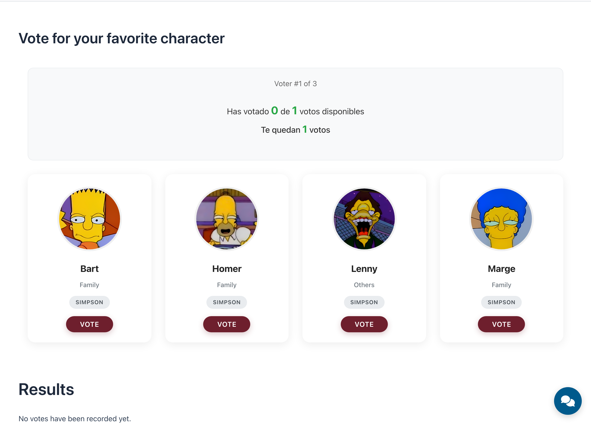
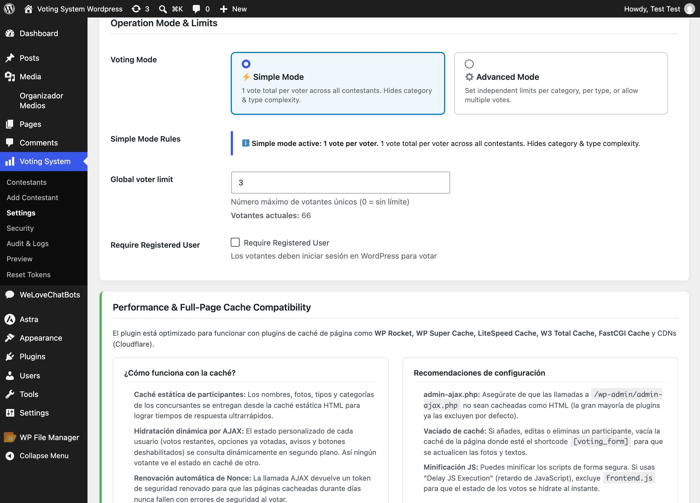
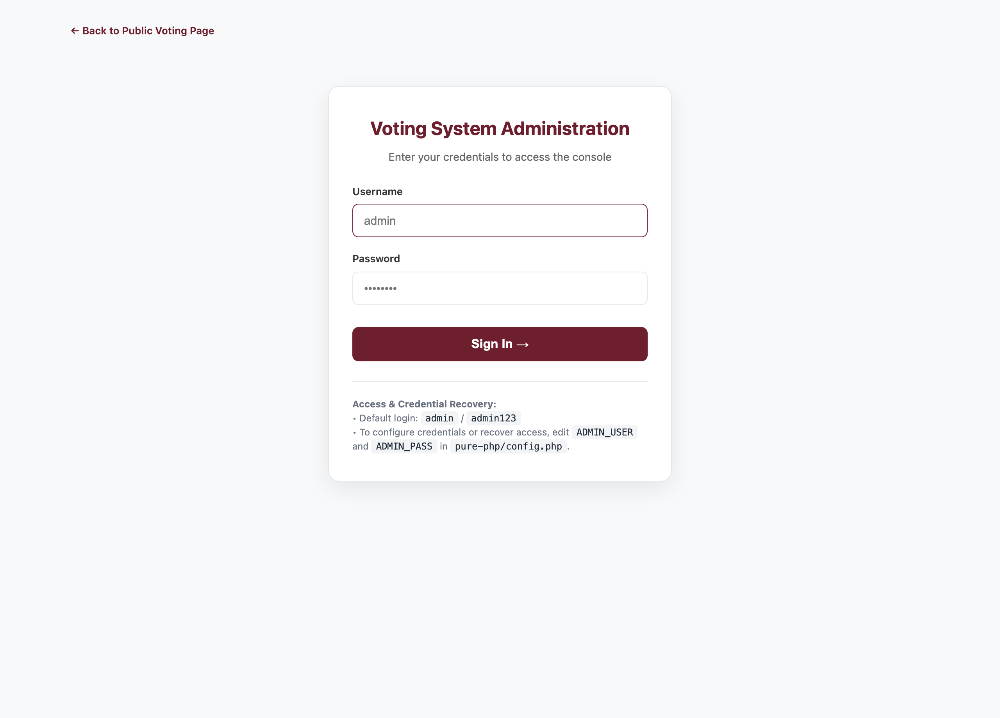
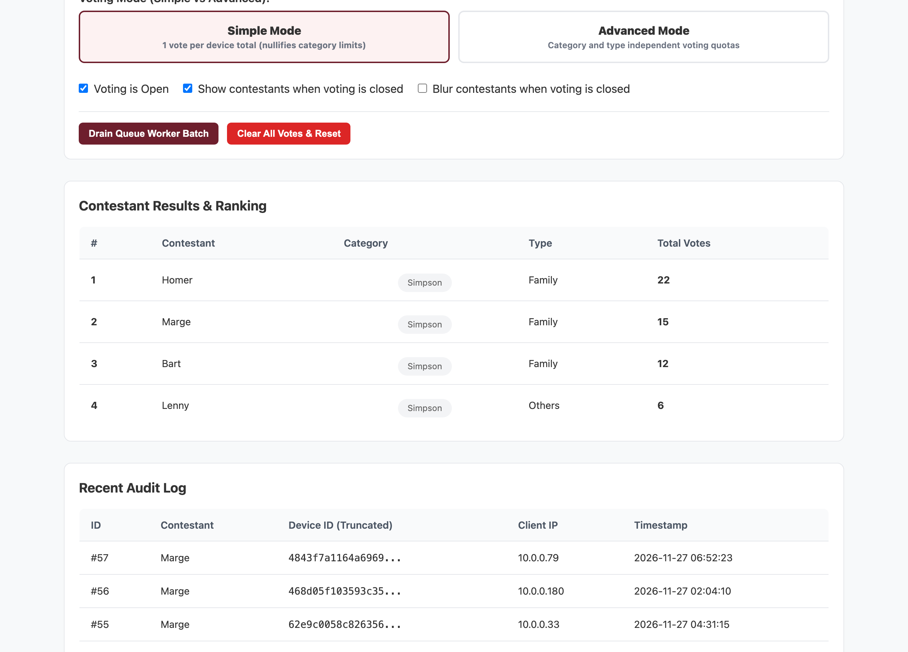

# Voting System

## Pure PHP version & WordPress Plugin version

[](https://github.com/christiancabrero/voting-system/releases/latest)
[](https://php.net)
[](https://wordpress.org)
[](#llicència)
[-purple.svg)](#internacionalització-i18n)
[](#rendiment-i-concurrència)

**Voting System** és una arquitectura de votacions de doble edició preparada per a producció, concebuda tant per a l'ecosistema WordPress com per a entorns independents d'altíssima concurrència:

1. [**Edició Plugin WordPress**](wordpress-plugin/): Plugin complet per a WordPress amb selector Mode Simple / Avançat, votació tancada amb participants visibles, targetes amb imatges nítides sense difuminat i botó de votació fixat a la part inferior, empremta digital de dispositiu antifrau i hidratació AJAX 100% compatible amb memòria cau (WP Super Cache, WP Rocket, LiteSpeed).
2. [**Edició Pure PHP d'Alta Concurrència**](pure-php/): Motor autònom i lleuger impulsat per una cua SQLite WAL (Productor-Consumidor), consola d'administració protegida per sessió, traduccions modulars per fitxers (`languages/*.php`) i serialització atòmica ACID capaç de gestionar **més de 750 peticions per segon** sense bloquejos de concurrència.

---

## 📖 Documentació Multilingüe

- 🇬🇧 **[English Documentation](README.md)**
- 🇪🇸 **[Documentación en Español](README.es.md)**
- 🏴 **[Documentació en Català (Actual)](README.ca.md)**
- 🇵🇹 **[Documentação em Português](README.pt.md)**
- 🇫🇷 **[Documentation en Français](README.fr.md)**
- 🇯🇵 **[日本語ドキュメント](README.ja.md)**
- 🇨🇳 **[中文文档](README.zh.md)**

---

## 📥 Descàrregues i Versions

Descarrega sempre la versió estable més recent directament des de:
👉 **[Descarregar Última Versió (Releases)](https://github.com/christiancabrero/voting-system/releases/latest)**

---

## 📸 Galeria Visual (Ambdues Edicions)

### 🌟 1. Edició Plugin WordPress


*01. Frontend Obert (Mode Simple) — Imatges nítides dels participants sense difuminar, etiqueta de categoria separada i botó de votar sempre a la part inferior de la targeta.*


*02. Estat Després de Votar (Esgotat) — Confirmació dinàmica immediata; l'opció votada mostra "✓ Votat" i la resta de botons queden bloquejats.*


*03. Votació Tancada amb Participants — Avís informatiu de tancament mantenint tots els participants visibles i nítids (el difuminat és opcional).*


*04. Panell d'Ajustos i Selector de Mode — Selector intuïtiu entre Mode Simple (1 vot) i Mode Avançat amb límits per categoria o tipus.*


*05. Guia de Compatibilitat amb Memòria Cau — Instruccions integrades al tauler sobre la hidratació dinàmica de nonces i estat del votant.*


*08. Resultats i Escrutini en Directe — Recompte de vots, percentatges i barres de progrés en temps real a WordPress.*


*09. Auditoria de Vots — Registre individual de vots que emmagatzema identificador de dispositiu, adreça IP, testimoni (token) i data.*


*10. Seguretat i Antifrau — Llistes d'accés per IP, control de ràtio de peticions i límit màxim de votants.*

---

### ⚡ 2. Edició Pure PHP d'Alta Concurrència


*06. Interfície Pública Standalone — Interfície reactiva amb selector de 7 idiomes (EN, ES, CA, PT, FR, JP, CN), rànquing en temps real i fotos nítides.*


*11. Pantalla d'Accés al Panell d'Administració — Control d'accés segur per credencials amb informació de recuperació.*


*07. Consola d'Administració Web — Monitorització de la cua WAL, commutador de modes, buidatge manual de la cua i gestió de participants.*


*12. Registre d'Auditoria en Temps Real — Registre d'ingesta ràpida amb identificadors de dispositiu i estat dels vots.*

---

## 📝 Documentació de Shortcodes a WordPress

### 1. `[voting_form]`
Genera la graella de targetes de votació pública.

| Atribut | Tipus | Per defecte | Descripció |
| :--- | :--- | :--- | :--- |
| `category` | `string` | `""` | Filtra participants per una categoria concreta (ex. `category="Simpson"`). |
| `type` | `string` | `""` | Filtra per tipus (ex. `type="Family"`). |
| `limit` | `int` | `0` | Sobreescriu el límit de vots per a aquesta instància (`0` fa servir el paràmetre global). |
| `columns` | `int` | `3` | Nombre de columnes a l'escriptori (`2`, `3` o `4`). |
| `show_results` | `int` | `0` | Posa `1` per incloure els resultats sota la graella. |

### 2. `[voting_results]`
Mostra el recompte verificat i els percentatges.

| Atribut | Tipus | Per defecte | Descripció |
| :--- | :--- | :--- | :--- |
| `category` | `string` | `""` | Filtra els resultats per categoria. |
| `type` | `string` | `""` | Filtra els resultats per tipus. |
| `show_percentages` | `int` | `1` | Mostra o amaga les barres de percentatge. |
| `show_numbers` | `int` | `1` | Mostra o amaga els nombres totals de vots. |
| `show_breakdown` | `int` | `1` | Mostra el llistat desglossat de participants. |

---

## 🔐 Accés al Panell d'Administració i Recuperació a Pure PHP

- **URL d'accés**: `http://el-teu-domini/pure-php/admin/`
- **Usuari**: `admin`
- **Contrasenya**: `admin123`

### Configuració i Recuperació
Definides a `pure-php/config.php`:
```php
define('ADMIN_USER', 'admin');
define('ADMIN_PASS', 'admin123');
```
Per modificar-les o restablir l'accés en cas de pèrdua, només cal editar el fitxer `pure-php/config.php` mitjançant FTP, SSH o el gestor d'arxius del servidor.

---

## 🌍 Internacionalització (i18n)

Suport nadiu complet per a **7 idiomes**:
- **Anglès (`en`)**
- **Espanyol (`es`)**
- **Català (`ca`)**
- **Portuguès (`pt`)**
- **Francès (`fr`)**
- **Japonès (`ja`)**
- **Xinès (`zh`)**

Fitxers modulars fàcilment traduïbles a `pure-php/languages/` i `includes/dictionary.php`.

---

## 📄 Llicència

- Edició Plugin WordPress: **GNU General Public License v2 (GPLv2)**.
- Edició Standalone Pure PHP: **Llicència MIT**.
