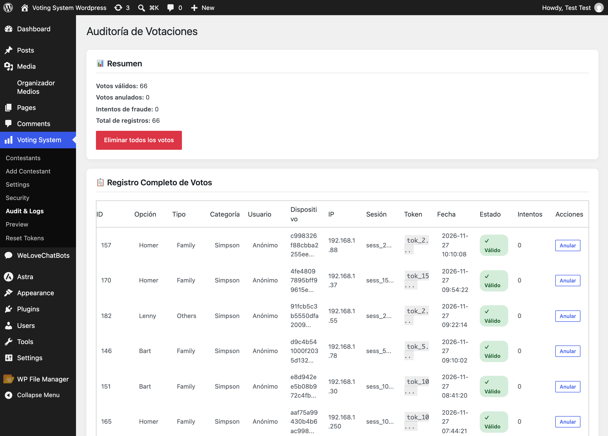

# Voting System

## Pure PHP version & WordPress Plugin version

[](https://github.com/christiancabrero/voting-system/releases/latest)
[](https://php.net)
[](https://wordpress.org)
[](#licença)
[-purple.svg)](#internacionalização-i18n)
[](#desempenho-e-concorrência)

**Voting System** é uma arquitetura de votações de dupla edição pronta para produção, desenvolvida tanto para o ecossistema WordPress quanto para ambientes autónomos de altíssima concorrência:

1. [**Edição Plugin WordPress**](wordpress-plugin/): Plugin completo para WordPress com seletor Modo Simples / Avançado, votação encerrada com participantes visíveis, cartões com fotos nítidas sem desfoque e botão de voto fixado na parte inferior, impressão digital de dispositivo contra fraude e hidratação AJAX 100% compatível com cache (WP Super Cache, WP Rocket, LiteSpeed).
2. [**Edição Pure PHP de Alta Concorrência**](pure-php/): Motor independente e ultra-leve com fila SQLite WAL (Produtor-Consumidor), consola de administração protegida por sessão, ficheiros de tradução modulares (`languages/*.php`) e serialização atómica ACID capaz de processar **mais de 750 pedidos por segundo** sem conflitos de bloqueio.

---

## 📖 Documentação Multilíngue

- 🇬🇧 **[English Documentation](README.md)**
- 🇪🇸 **[Documentación en Español](README.es.md)**
- 🏴 **[Documentació en Català](README.ca.md)**
- 🇵🇹 **[Documentação em Português (Atual)](README.pt.md)**
- 🇫🇷 **[Documentation en Français](README.fr.md)**
- 🇯🇵 **[日本語ドキュメント](README.ja.md)**
- 🇨🇳 **[中文文档](README.zh.md)**

---

## 📥 Transferências e Versões

Transfira sempre a versão estável mais recente a partir de:
👉 **[Transferir Última Versão (Releases)](https://github.com/christiancabrero/voting-system/releases/latest)**

---

## 📸 Galeria Visual (Ambas as Edições)

### 🌟 1. Edição Plugin WordPress


*01. Frontend Aberto (Modo Simples) — Fotografias nítidas sem desfoque, categoria destacada acima do botão e ação de votar sempre na base do cartão.*


*02. Estado Pós-Voto (Esgotado) — Confirmação imediata; opção votada marcada como "✓ Votado" e restantes botões desativados.*


*03. Votação Encerrada com Participantes — Faixa informativa de encerramento mantendo todos os candidatos visíveis e nítidos (desfoque configurável).*


*04. Definições e Seletor de Modo — Gestão intuitiva entre Modo Simples (1 voto por pessoa) e Modo Avançado.*


*05. Guia de Compatibilidade com Cache — Instruções integradas no painel sobre a hidratação dinâmica de nonces e estado do votante.*


*08. Resultados e Apuramento em Direto — Contagem de votos, percentagens e detalhe por concorrente em tempo real no WordPress.*


*09. Auditoria de Votos — Registo de auditoria individual com ID do dispositivo, endereço IP, token e carimbo temporal.*


*10. Segurança e Antifraude — Restrições por lista de IPs, limite de taxa de requisições e limite global de votantes.*

---

### ⚡ 2. Edição Pure PHP de Alta Concorrência


*06. Interface Pública Standalone — Interface moderna com seletor de 7 idiomas (EN, ES, CA, PT, FR, JP, CN), classificação em direto e cartões nítidos.*


*11. Acesso à Consola de Administração — Autenticação segura por credenciais com instruções de recuperação.*


*07. Consola de Administração Web — Monitor de fila WAL, alternador de modos, esvaziamento manual e gestão de opções.*


*12. Registo de Auditoria em Tempo Real — Acompanhamento em direto dos votos processados e em fila com impressões digitais.*

---

## 📝 Documentação de Shortcodes no WordPress

### 1. `[voting_form]`
Gera os cartões públicos de votação.

| Atributo | Tipo | Predefinição | Descrição |
| :--- | :--- | :--- | :--- |
| `category` | `string` | `""` | Filtra participantes por categoria (ex: `category="Simpson"`). |
| `type` | `string` | `""` | Filtra por tipo (ex: `type="Family"`). |
| `limit` | `int` | `0` | Substitui o limite de votos nesta instância (`0` usa o valor global). |
| `columns` | `int` | `3` | Número de colunas no ambiente de trabalho (`2`, `3` ou `4`). |
| `show_results` | `int` | `0` | Defina `1` para mostrar os resultados imediatamente abaixo da grelha. |

### 2. `[voting_results]`
Exibe a contagem de votos e percentagens em tempo real.

| Atributo | Tipo | Predefinição | Descrição |
| :--- | :--- | :--- | :--- |
| `category` | `string` | `""` | Filtra resultados por categoria. |
| `type` | `string` | `""` | Filtra resultados por tipo. |
| `show_percentages` | `int` | `1` | Mostra ou oculta as barras de percentagem. |
| `show_numbers` | `int` | `1` | Mostra ou oculta a contagem numérica de votos. |
| `show_breakdown` | `int` | `1` | Mostra o detalhe completo por concorrente. |

---

## 🔐 Acesso à Administração e Recuperação no Pure PHP

- **URL**: `http://o-seu-dominio/pure-php/admin/`
- **Utilizador**: `admin`
- **Palavra-passe**: `admin123`

### Configuração e Recuperação
Geridas em `pure-php/config.php`:
```php
define('ADMIN_USER', 'admin');
define('ADMIN_PASS', 'admin123');
```
Para redefinir acessos ou recuperar a palavra-passe, basta aceder ao ficheiro `pure-php/config.php` via FTP, SSH ou gestor de ficheiros e atualizar a constante `ADMIN_PASS`.

---

## 🌍 Internacionalização (i18n)

Suporte nativo em **7 idiomas**:
`en`, `es`, `ca`, `pt`, `fr`, `ja`, `zh`.
Ficheiros dedicados em `pure-php/languages/` e `includes/dictionary.php`.

---

## 📄 Licença

- Edição Plugin WordPress: **GPLv2**.
- Edição Pure PHP: **Licença MIT**.
