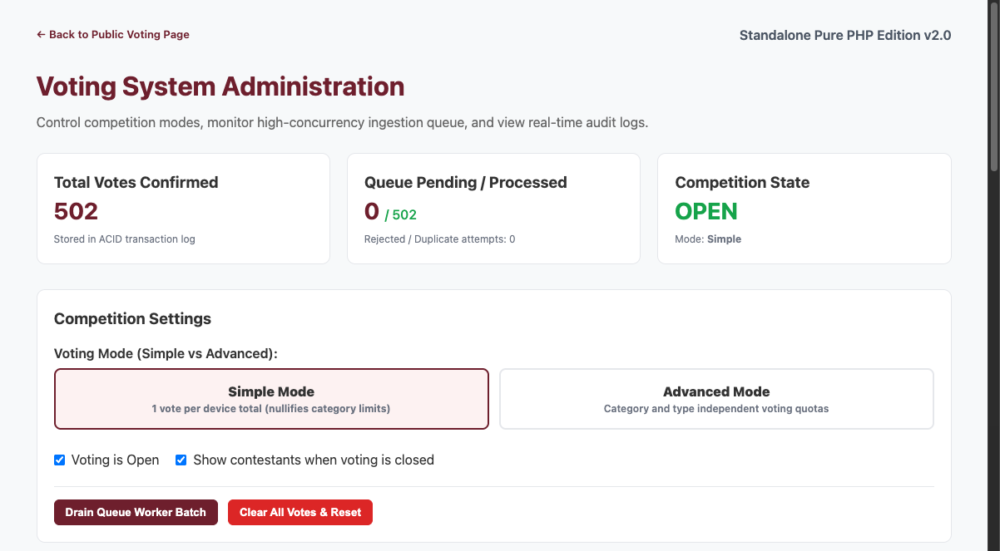

# 投票システム（高並行処理 Pure PHP エディション）

フレームワークに依存せず、純粋なPHPのみで構築された超高速な独立型投票システムです。**Producer-Consumer（キュー）パターン**を採用し、超高速なSQLite Write-Ahead Logging（WAL）およびMySQL PDOに対応しています。**毎秒100〜1,000件以上の同時投票リクエスト**をデータベースのロック競合ゼロで処理し、**競合状態（レースコンディション）による二重投票を100%防止**します。

---

## 📸 スクリーンショット


*01. リアクティブな公開投票画面*


*02. Web管理コンソール & リアルタイムキュー監視*

---

## 🚀 アーキテクチャの特長

```
[ クライアントからのリクエスト (100 - 1,000 req/s) ]
                  │
                  ▼
   [ 高速インジェスチョン層 (api/vote.php) ]
    - デバイス紐付け型ステートレスHMAC CSRF（PHPセッション不要）
    - スライディングウィンドウ式IPレート制限
    - インメモリ/アトミック高速重複排除
                  │
                  ▼
     [ 追加専用 SQLite WAL キュー ]  <-- 1ミリ秒未満の非ブロッキング書き込み
                  │
                  ▼
   [ ワーカー処理エンジン (worker.php) ]
    - シリアル化されたACIDトランザクション処理
    - 厳格な「正確に1回（Exactly-Once）」投票保証
    - リアルタイム集計および監査ログ
                  │
                  ▼
    [ 確定済み投票データとランキング結果 ]
```

### 1. 高並行処理キューアーキテクチャ
- 従来の直接データベース書き込み方式では、同時アクセス時にコネクションプール枯渇やテーブルロック、デッドロックが発生します。
- 本システムは**リクエスト受付**と**トランザクション処理**を分離:
  - ユーザーの投票リクエストは、**1ミリ秒未満**でWALキューに追加され即時応答。
  - ワーカーがバッチ単位でトランザクション内にて整合性を検証して集計。
  - バックグラウンドデーモン（`php worker.php --daemon`）、Cron定期実行（`php worker.php --once`）、または自動ドレイン（共有ホスティング用）に対応。

### 2. レースコンディション（二重投票）の完全防止
- 同一ユーザーまたは悪意あるBotが、全く同一のミリ秒で50〜100件の同時投票リクエストを送信した場合でも:
  - 事前チェック層で重複を検知。
  - データベーストランザクション内の制約により、**厳格に1票のみ**が確定され、残りの重複リクエストは安全に拒否されます。

### 3. PHPセッションに依存しないステートレスHMAC CSRF
- 通常のPHPセッション（`session_start()`）はディスク上のセッションファイルを排他ロックするため、並行アクセス時にボトルネックになります。
- デバイス固有IDに紐づく**ステートレスHMAC CSRFトークン**（`hash_hmac('sha256', $deviceId . date('YmdH'), SECRET)`）を採用。
- セッションロックを完全に排除しつつ、強固なCSRF耐性を実現しました。

### 4. 完全な多言語対応（英語、スペイン語、カタルーニャ語）
- 英語（`en`）を標準主言語として設計。
- 英語、スペイン語（`es`）、カタルーニャ語（`ca`）を完全サポート。
- URLパラメータ、Cookie、ブラウザ言語ヘッダーからの自動判別機能を搭載。

---

## ⚡ 並行処理ストレステスト結果

同梱のテストスイート（`tests/stress_test.php`）によるベンチマーク実測値:

| 項目 | 200件 同時リクエスト | 500件 同時リクエスト |
| :--- | :--- | :--- |
| **所要時間** | **0.345秒** | **0.662秒** |
| **スループット** | **580.17 req/sec** | **755.61 req/sec** |
| **受け付け成功率** | 200 / 200 (**100.0%**) | 500 / 500 (**100.0%**) |
| **エラー / タイムアウト** | **0件** | **0件** |
| **二重投票攻撃（同一端末から50件同時）** | **1件確定、49件正常拒否** | **1件確定、49件正常拒否** |
| **レースコンディション判定** | **合格（100% 冪等性確保）** | **合格（100% 冪等性確保）** |

---

## 📁 ディレクトリ構造

```text
voting-system-pure-php/
├── index.php                 # フロントエンド画面（ワインレッド・コンクール仕様）
├── api/
│   ├── vote.php             # 高並行投票受付エンドポイント
│   ├── state.php            # 有権者状態の動的ハイドレーション
│   ├── participants.php     # 候補者一覧（ETagキャッシュ対応）
│   └── stats.php            # リアルタイム統計・結果API
├── admin/
│   ├── index.php            # 管理画面（シンプル/アドバンス切り替え、キュー監視）
│   └── action.php           # 管理操作ハンドラー
├── worker.php               # CLIキュー処理デーモン / Cronランナー
├── config.php               # システム設定、DB接続設定
├── includes/
│   ├── Database.php         # SQLite WAL / MySQL PDOエンジン
│   ├── Queue.php            # スレッドセーフなキュー管理クラス
│   ├── Storage.php          # 設定・候補者データ管理クラス
│   ├── Voter.php            # デバイス指紋認証、レート制限、HMAC CSRF
│   └── I18n.php             # 多言語辞書エンジン（EN, ES, CA）
├── assets/
│   ├── css/style.css        # モダン＆レスポンシブスタイル
│   └── js/app.js            # 非同期リアクティブJavaScriptクライアント
├── data/                    # データベース保護ディレクトリ
│   └── .htaccess            # SQLiteファイルの直接アクセス遮断
└── tests/
    └── stress_test.php      # 並行処理・ストレステストベンチマーク
```

---

## 🛠️ インストール & 実行方法

### 動作要件
- PHP 8.0 以上
- PDO拡張（SQLite `pdo_sqlite` または MySQL `pdo_mysql`）
- cURL拡張（ストレステスト実行用）

### クイックスタート
1. `voting-system-pure-php` フォルダをWebサーバーの公開ディレクトリに配置します。
2. PHPの組み込みサーバーで起動する場合:
   ```bash
   php -S localhost:8080 -t .
   ```
3. ブラウザで `http://localhost:8080/` にアクセスします。
4. 管理画面は `http://localhost:8080/admin/` で確認できます。

### CLIワーカーの実行（推奨運用）
バックグラウンドでキューを常時処理する場合:
```bash
php worker.php --daemon
```
またはCronで1分ごとにバッチ処理を実行する場合:
```bash
* * * * * php /path/to/voting-system-pure-php/worker.php --once
```

### 並行処理ベンチマークテストの実行
```bash
php tests/stress_test.php 200
```
