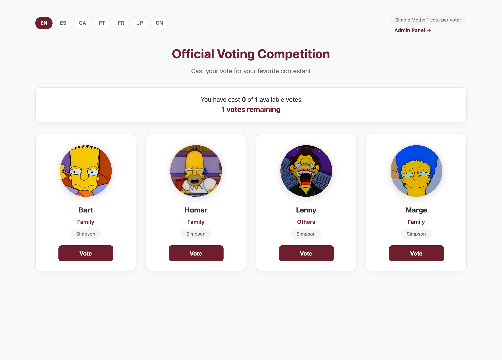

# Voting System（Pure PHP 纯代码高并发版）

[](https://github.com/christiancabrero/voting-system/releases/latest)
[](https://php.net)
[](https://sqlite.org)
[](#license)

---

## 📥 [Download Latest Release](https://github.com/christiancabrero/voting-system/releases/latest)

---

## 📸 功能截图


*01. 独立公开前台界面 — 现代化响应式卡片，支持 7 种语言切换（EN、ES、CA、PT、FR、JP、CN），实时榜单排名。*


*11. 管理后台登录验证网关 — 安全的凭证登录界面，内置配置与找回说明。*


*02. Web 管理控制台 — WAL 队列状态监控、模式切换、手动执行队列消费与参赛选手管理。*


*12. 实时审计日志监控 — 毫秒级展示已处理及排队中的选票记录与设备识别指纹。*

---

## 🔐 管理后台访问与凭证配置/恢复

Pure PHP 版本在 `/admin/` 提供了独立的后台管理控制台。
- **后台地址**：`http://your-domain/pure-php/admin/`
- **默认用户名**：`admin`
- **默认密码**：`admin123`

### 凭证配置与找回恢复
所有凭证由 `pure-php/config.php` 集中管理：
```php
define('ADMIN_USER', 'admin');
define('ADMIN_PASS', 'admin123');
```
若忘记密码，无需操作数据库，只需通过 FTP、SSH 或文件管理器编辑 `pure-php/config.php` 并重设 `ADMIN_PASS` 即可即时生效。

---

## 🌍 国际化多语言支持 (i18n)
系统全面原生支持 7 种语言：英语 (en)、西班牙语 (es)、加泰罗尼亚语 (ca)、葡萄牙语 (pt)、法语 (fr)、日语 (ja)、中文 (zh)。
语言字典以独立 PHP 文件存放在 `languages/{lang}.php`，扩展极其简便。

---

## 📄 开源协议
- MIT License
