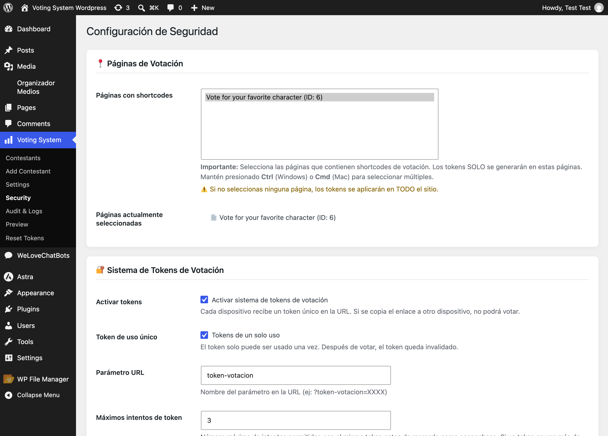

# WordPress Voting System (Edició Moderna de Competició)

---

## 📥 [Download Latest Release](https://github.com/christiancabrero/voting-system/releases/latest)

---

## 📸 Galeria Visual

*01. Frontend en Mode Simple (Obert) — Imatges nítides sense difuminar, categoria destacada i botó al peu.*

*02. Estat Després de Votar (Esgotat) — Confirmació dinàmica immediata; opció votada amb '✓ Votat' i botons bloquejats.*

*03. Votacions Tancades amb Participants Visibles — Avís de tancament mantenint els participants visibles i nítids.*

*04. Selector de Mode Simple / Avançat — Selector intuïtiu entre Mode Simple (1 vot) i Mode Avançat amb límits.*

*05. Guia de Compatibilitat amb Memòria Cau — Instruccions integrades al tauler sobre la hidratació dinàmica.*

*08. Escrutini i Resultats en Directe — Recompte en temps real, percentatges i desglossament a WordPress.*

*09. Auditoria de Vots — Registre individual amb identificador de dispositiu, IP, testimoni (token) i data.*

*10. Seguretat i Control Antifrau — Llistes d'accés per IP, control de ràtio de peticions i límit màxim de votants.*

---

## 📝 Documentació de Shortcodes

### 1. `[voting_form]`
- `category=""`: Filter contestants by category.
- `type=""`: Filter contestants by type.
- `limit="0"`: Custom vote quota for this form.
- `columns="3"`: Grid desktop columns (`2`, `3`, `4`).
- `show_results="0"`: Display results below voting cards.

### 2. `[voting_results]`
- `category=""`: Filter results by category.
- `type=""`: Filter results by type.
- `show_percentages="1"`: Show percentage bars.
- `show_numbers="1"`: Show total vote counts.
- `show_breakdown="1"`: Detailed contestants breakdown.

---

## 🌍 Internacionalització (i18n)
Completament operatiu en 7 idiomes: anglès (en), espanyol (es), català (ca), portuguès (pt), francès (fr), japonès (ja) i xinès (zh).
Facilitat de traducció mitjançant fitxers independents a `languages/{lang}.php`.

---

## 📄 Llicència
- GNU General Public License v2 (GPLv2)
