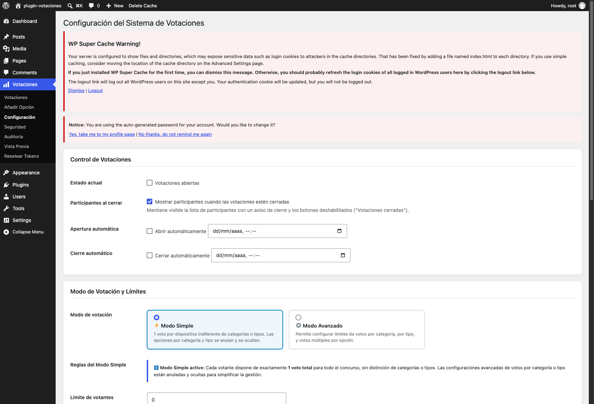

# Voting System para WordPress (Edición Concurso)

Plugin de votaciones de alto rendimiento para WordPress que incluye **Modo Simple** (1 voto por dispositivo/votante), **Límites Avanzados por Categoría**, **Votaciones Cerradas con Participantes Visibles** e **Hidratación Dinámica AJAX 100% Compatible con Plugins de Caché** (WP Super Cache, WP Rocket, LiteSpeed Cache). Incluye protección de privacidad, detección anti-fraude por huella digital del dispositivo y soporte multilingüe (Inglés, Español, Catalán).

---

## 🌟 Características Principales

### 1. Switch de Modo Simple vs. Modo Avanzado
- **Modo Simple (1 voto por votante global)**:
  - Trata a todos los concursantes como un grupo único, sin distinción de categorías o tipos.
  - Limita estrictamente a cada votante/dispositivo a exactamente **1 voto**.
  - Switch interactivo en `Ajustes > Votaciones` para alternar entre Modo Simple y Avanzado.
  - Al activar el Modo Simple, las opciones complejas de límites por categorías, tipos y votos múltiples se ocultan automáticamente en el backend para una experiencia limpia y sin distracciones.
- **Modo Avanzado**:
  - Establece límites independientes por categoría, por tipo o votos globales.
  - Permite opcionalmente múltiples votos por participante.

### 2. Votaciones Cerradas con Participantes Visibles
- Nueva opción: **"Mostrar participantes cuando las votaciones estén cerradas"** (`vs_closed_show_participants`).
- Cuando las votaciones se cierran (manualmente o mediante programación de fechas):
  - Se muestra un banner informativo destacado en la parte superior.
  - Todos los participantes siguen visibles al 100% con sus imágenes, títulos, categorías y tipos.
  - Todos los botones de votación quedan bloqueados (`disabled`) con la clase `.vs-btn-closed` y texto traducido: **"Votaciones cerradas"** (ES) / **"Votacions tancades"** (CA) / **"Voting closed"** (EN).

### 3. Caché Estática de Alto Rendimiento e Hidratación Dinámica AJAX
- **Problema Solucionado**: Los plugins de caché de página completa suelen servir HTML estático con contadores desactualizados (ej. mostrando *"0 de 1 votos emitidos"* a alguien que ya votó) o tokens nonce caducados.
- **La Solución**:
  - El listado de participantes, fotos y estructura queda **100% cacheado estáticamente** en memoria o disco por WP Super Cache, WP Rocket, LiteSpeed o CDN (Cloudflare), reduciendo el consumo del servidor en picos masivos de tráfico.
  - Al cargar la página, un endpoint asíncrono ultraligero (`vs_get_voter_state`) consulta el estado real del votante.
  - Renueva el security nonce dinámicamente para que nunca caduque en páginas cacheadas.
  - Hidrata en tiempo real los votos restantes, bloquea los botones agotados y añade distintivos **"✓ Votado"** a las opciones votadas.
  - Incluye una completa **Guía de Compatibilidad de Caché** integrada en los ajustes del plugin.

### 4. Motor Multilingüe con Detección Automática
- **Idioma Principal**: Inglés (`en`).
- **Idiomas Soportados**: Inglés (`en`), Español (`es`) y Catalán (`ca`).
- **Jerarquía de Detección**:
  1. Parámetro de URL (`?lang=en|es|ca`) o cookie (`vs_lang`).
  2. Idioma activo de Polylang o WPML.
  3. Locale del sitio de WordPress (`determine_locale()` / `get_locale()`).
  4. Cabecera `Accept-Language` del navegador.
  5. Valor por defecto: Inglés (`en`).

### 5. Diseño Visual Elegante y Privacidad
- Inspirado en interfaces de certámenes y concursos de música clásica:
  - Color corporativo burdeos (`#6E1F2D`) con toques dorados (`#a67c4c`).
  - Imágenes circulares uniformes (`aspect-ratio: 1/1; border-radius: 50%`).
  - Desenfoque de privacidad integrado en demostraciones y entornos de auditoría.
  - Cuadrícula responsive optimizada para dispositivos móviles.

---

## 📸 Capturas de Pantalla


*01. Frontend en Modo Simple (Abierto)*


*02. Estado tras Votar (Voto Agotado)*


*03. Votaciones Cerradas con Participantes*


*04. Switch Backend Modo Simple / Avanzado*


*05. Guía de Caché en el Backend*

---

## 🚀 Instalación y Uso

1. Copiar la carpeta `voting-system` en `wp-content/plugins/`.
2. Activar el plugin desde el panel de WordPress (`Plugins > Plugins instalados`).
3. Ir a **Votaciones > Ajustes**:
   - Elegir **Modo Simple** (1 voto global) o **Modo Avanzado**.
   - Activar **"Mostrar participantes cuando las votaciones estén cerradas"** si se desea.
   - Configurar fechas automáticas o controlar la apertura/cierre de forma manual.
4. Añadir participantes en **Votaciones > Añadir Participante**.
5. Insertar el shortcode en cualquier página o entrada:
   ```text
   [voting_form]
   ```
