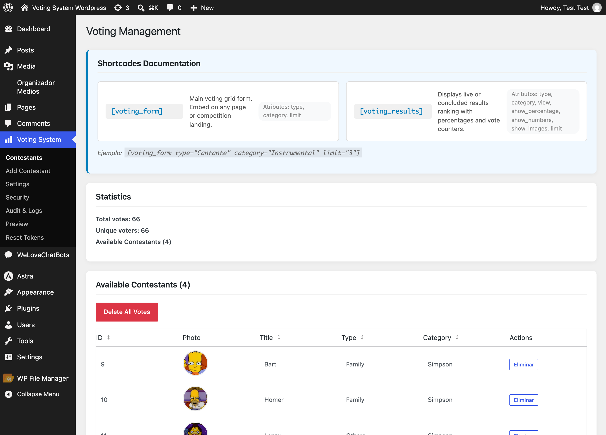

# WordPress Voting System (Édition Compétition Moderne)

---

## 📥 [Download Latest Release](https://github.com/christiancabrero/voting-system/releases/latest)

---

## 📸 Galerie Visuelle

*01. Frontend en Mode Simple (Ouvert) — Photos nettes sans flou, catégorie distincte et bouton de vote au bas de la carte.*

*02. État Post-Vote (Épuisé) — Confirmation dynamique immédiate ; candidat avec '✓ Voté' et boutons verrouillés.*

*03. Vote Clos avec Participants Visibles — Bannière d'alerte tout en maintenant les candidats visibles et nets.*

*04. Sélecteur de Mode Simple / Avancé — Sélection intuitive entre Mode Simple (1 vote) et Mode Avancé avec limites.*

*05. Guide de Compatibilité Cache — Documentation intégrée sur l'hydratation asynchrone des nonces et états.*

*08. Résultats et Dépouillement en Direct — Décompte en temps réel, pourcentages et statistiques sur WordPress.*

*09. Audit des Votes — Journal inviolable avec identifiant de l'appareil, IP, jeton et horodatage.*

*10. Sécurité et Antifraude — Listes d'adresses IP autorisées, régulation du débit et limite de votants.*

---

## 📝 Documentation des Shortcodes

### 1. `[voting_form]`
- `category=""`: Filter contestants by category.
- `type=""`: Filter contestants by type.
- `limit="0"`: Custom vote quota for this form.
- `columns="3"`: Grid desktop columns (`2`, `3`, `4`).
- `show_results="0"`: Display results below voting cards.

### 2. `[voting_results]`
- `category=""`: Filter results by category.
- `type=""`: Filter results by type.
- `show_percentages="1"`: Show percentage bars.
- `show_numbers="1"`: Show total vote counts.
- `show_breakdown="1"`: Detailed contestants breakdown.

---

## 🌍 Internationalisation (i18n)
Prise en charge intégrale de 7 langues : anglais (en), espagnol (es), catalan (ca), portugais (pt), français (fr), japonais (ja) et chinois (zh).
Fichiers modulaires modifiables dans `languages/{lang}.php`.

---

## 📄 Licence
- GNU General Public License v2 (GPLv2)
