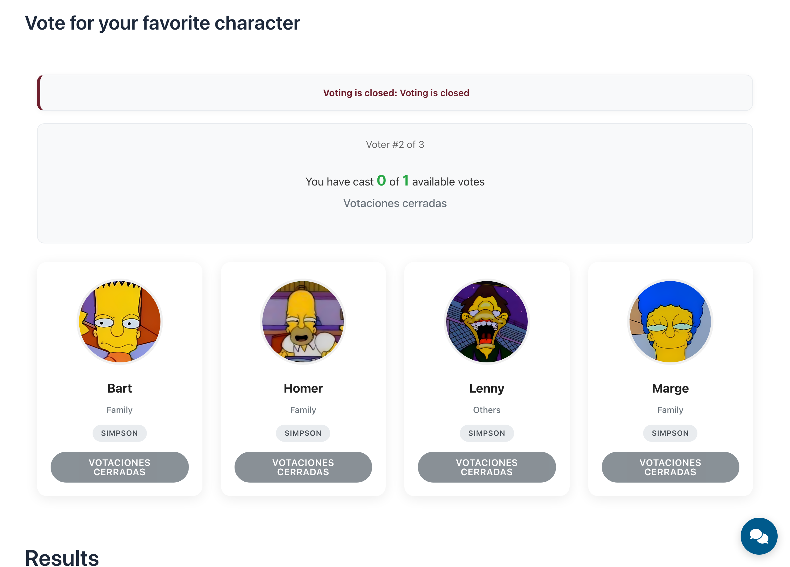

# WordPress Voting System (Modern Competition Edition)

---

## 📥 [Download Latest Release](https://github.com/christiancabrero/voting-system/releases/latest)

---

## 📸 Visual Showcase

*01. Frontend in Simple Mode (Open) — Crisp unblurred contestant photos, category tag properly stacked above vote button.*

*02. Post-Vote State (Votes Exhausted) — Instant dynamic confirmation; candidate shows '✓ Voted' and remaining buttons lock.*

*03. Closed Voting with Participants Visible — Status banner shown while contestants remain visible and unblurred.*

*04. Backend Simple / Advanced Mode Switch — Interactive switcher between Simple (1 vote) and Advanced category rules.*

*05. Cache Compatibility Guide in Backend — Built-in reference explaining AJAX hydration with caching plugins.*

*08. Live Results & Breakdown — Real-time vote tallies, percentage bars, and contestant status in WordPress.*

*09. Audit & Votes Trail — Individual vote audit log with device ID, IP, token, and timestamp.*

*10. Security & Anti-Fraud Settings — IP whitelist/blacklist, request rate limiting, and voter limits.*

---

## 📝 Shortcodes Documentation

### 1. `[voting_form]`
- `category=""`: Filter contestants by category.
- `type=""`: Filter contestants by type.
- `limit="0"`: Custom vote quota for this form.
- `columns="3"`: Grid desktop columns (`2`, `3`, `4`).
- `show_results="0"`: Display results below voting cards.

### 2. `[voting_results]`
- `category=""`: Filter results by category.
- `type=""`: Filter results by type.
- `show_percentages="1"`: Show percentage bars.
- `show_numbers="1"`: Show total vote counts.
- `show_breakdown="1"`: Detailed contestants breakdown.

---

## 🌍 Internationalization (i18n)
Supported in 7 languages: English (en), Spanish (es), Catalan (ca), Portuguese (pt), French (fr), Japanese (ja), Chinese (zh).
Easily extensible via clean array files in `languages/{lang}.php`.

---

## 📄 License
- GNU General Public License v2 (GPLv2)
