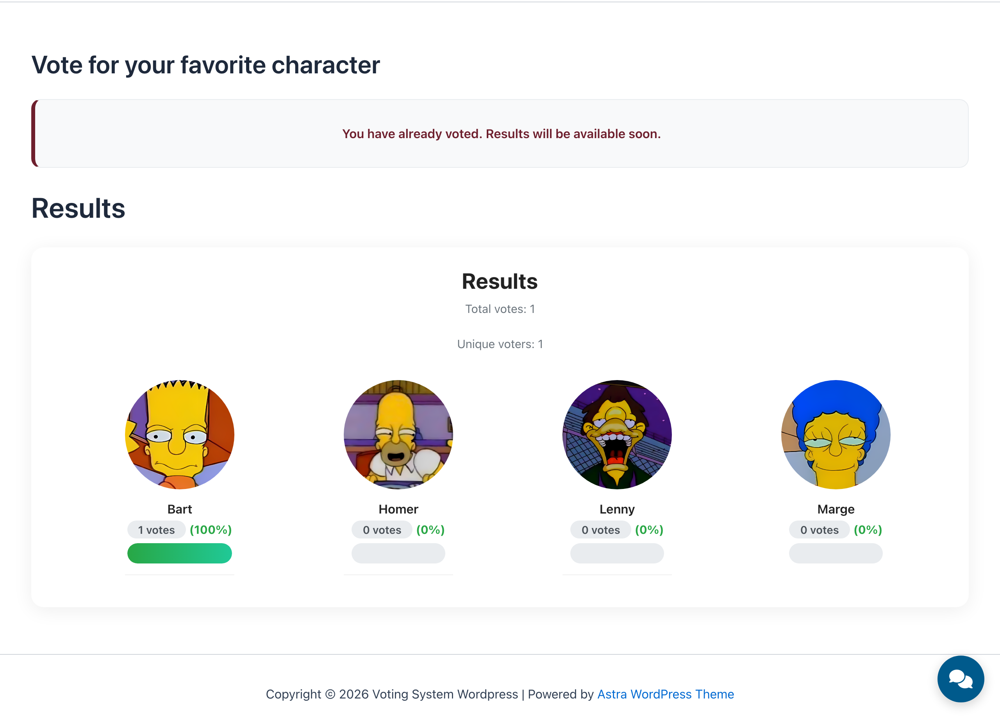

# WordPress Voting System (Edição Moderna de Competição)

---

## 📥 [Download Latest Release](https://github.com/christiancabrero/voting-system/releases/latest)

---

## 📸 Galeria Visual

*01. Frontend em Modo Simples (Aberto) — Fotografias nítidas sem desfoque, categoria separada e botão de votar na base.*

*02. Estado Pós-Voto (Esgotado) — Confirmação imediata; opção votada marcada como '✓ Votado' e botões desativados.*

*03. Votação Encerrada com Participantes Visíveis — Faixa de encerramento mantendo todos os candidatos visíveis e nítidos.*

*04. Definições e Seletor de Modo — Gestão intuitiva entre Modo Simples (1 voto por pessoa) e Modo Avançado.*

*05. Guia de Compatibilidade com Cache — Instruções integradas no painel sobre a hidratação dinâmica com cache.*

*08. Resultados e Apuramento em Direto — Contagem de votos, percentagens e detalhe por concorrente no WordPress.*

*09. Auditoria de Votos — Registo individual com ID do dispositivo, endereço IP, token e carimbo temporal.*

*10. Segurança e Antifraude — Restrições por lista de IPs, limite de taxa de requisições e limite de votantes.*

---

## 📝 Documentação de Shortcodes

### 1. `[voting_form]`
- `category=""`: Filter contestants by category.
- `type=""`: Filter contestants by type.
- `limit="0"`: Custom vote quota for this form.
- `columns="3"`: Grid desktop columns (`2`, `3`, `4`).
- `show_results="0"`: Display results below voting cards.

### 2. `[voting_results]`
- `category=""`: Filter results by category.
- `type=""`: Filter results by type.
- `show_percentages="1"`: Show percentage bars.
- `show_numbers="1"`: Show total vote counts.
- `show_breakdown="1"`: Detailed contestants breakdown.

---

## 🌍 Internacionalização (i18n)
Suporte em 7 idiomas: inglês (en), espanhol (es), catalão (ca), português (pt), francês (fr), japonês (ja) e chinês (zh).
Ficheiros modulares em `languages/{lang}.php`.

---

## 📄 Licença
- GNU General Public License v2 (GPLv2)
